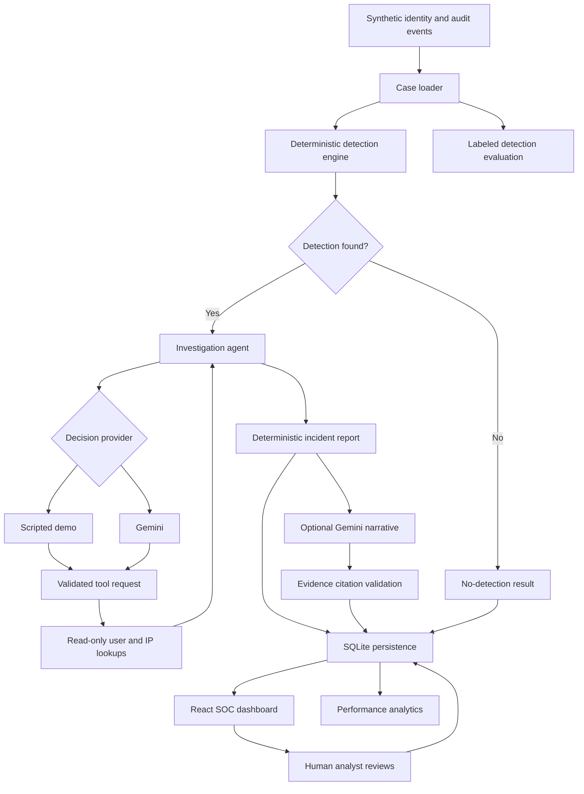

# Sentinel Casework

### Evidence-first, AI-assisted SOC investigation platform

Sentinel Casework is a cybersecurity portfolio project demonstrating
how AI can assist a Security Operations Center (SOC) analyst while
preserving verifiable evidence and human oversight.

The project combines deterministic identity-threat detection,
read-only investigation tools, an AI decision agent, evidence-grounded
incident reporting, analyst reviews, and performance evaluation.

**Scope:** Local portfolio prototype using synthetic security events.
It is not a production SIEM, SOAR platform, or autonomous response tool.

## Key capabilities

| Capability | Implementation |
|---|---|
| Security detection | Rule-based MFA-fatigue and privileged-role correlation |
| Case management | Six replayable synthetic identity scenarios |
| Agent investigation | Bounded, read-only user/IP lookups |
| AI provider | Gemini with structured decision output |
| Offline execution | Deterministic demo agent |
| Evidence validation | Source event ID checks |
| Incident reporting | Deterministic evidence-backed timeline |
| AI narrative | Gemini-generated explanation with validated event references |
| Human review | Persisted analyst verdicts and notes |
| Investigation history | SQLite-backed investigation records |
| Performance analytics | Duration, model decisions, tool lookups |
| Detection evaluation | Confusion matrix, precision, recall and F1 |
| Dashboard | React and Vite |

## Architecture



The system keeps AI-generated decisions separate from source evidence.
Python validates requested investigation tools and referenced event IDs.

## Technology stack

**Backend:** Python 3.10+, FastAPI, Pydantic, SQLite

**AI:** Google Gemini through the `google-genai` SDK

**Frontend:** React, Vite, JavaScript, CSS

**Testing:** Python unittest, FastAPI TestClient, Vite build

**Evaluation:** Deterministic detection evaluation over synthetic cases

## Installation

Requirements:

- Python 3.10 or newer
- Node.js and npm
- Git
- Gemini API key (optional for demo mode)

Clone the repository:

```bash
git clone https://github.com/Abhinav-ganapuram/sentinal-casework.git
cd sentinal-casework
```

Create a Python virtual environment.

On Windows PowerShell:

```powershell
py -3.10 -m venv .venv
.\.venv\Scripts\Activate.ps1
python -m pip install -r requirements.txt
```

Start FastAPI:

```powershell
python -m uvicorn sentinel_casework.api:app --reload --port 8000
```

In a second terminal:

```powershell
cd frontend
npm install
npm run dev
```

Open:

- Dashboard: http://localhost:5173
- API documentation: http://127.0.0.1:8000/docs
- API health: http://127.0.0.1:8000/health

The dashboard uses Vite's development proxy to reach FastAPI.

## Gemini configuration

Gemini is optional. Demo investigations run without any cloud credentials.

In the backend PowerShell terminal:

```powershell
$env:GEMINI_API_KEY = (Read-Host "Gemini API key").Trim()
$env:SENTINEL_GEMINI_MODEL = "gemini-3.8-flash"
```

Use a model available to your Google AI project. The model name is
configurable and availability may change.

Restart the backend from the terminal containing these variables.

Do not put real API keys in source files, frontend code, commits, or
screenshots.

## How to use Sentinel

1. Open the dashboard and select a case.
2. Inspect the event timeline and detection context.
3. Select Demo or Gemini investigation mode.
4. Run the investigation.
5. Review detected findings and recorded tool lookups.
6. Inspect the deterministic incident report.
7. Optionally generate an AI incident narrative.
8. Review evidence citations and uncertainties.
9. Submit a human analyst verdict and notes.
10. Reopen the investigation to inspect saved results.
11. View aggregate investigation performance metrics.

## Synthetic scenarios

| Case | Description | Evaluation label |
|---|---|---|
| CASE-001 | MFA fatigue followed by privileged access | Suspicious |
| CASE-002 | Unsuccessful MFA retry activity | Benign |
| CASE-003 | MFA fatigue and Global Administrator grant | Suspicious |
| CASE-004 | MFA fatigue near correlation timing limits | Suspicious |
| CASE-005 | MFA activity with a role grant from another IP | Benign |
| CASE-006 | MFA activity with delayed role grant | Benign |

The labels are expectations for the configured detection, not
universal statements about malicious intent.

## Evaluation

Run all Python tests:

```bash
python -m unittest discover -s tests -v
```

Evaluate the detection engine:

```bash
python -m sentinel_casework.evaluate
```

Build the frontend:

```bash
cd frontend
npm run build
```

The evaluation command generates `data/evaluation.json`.

The six scenario fixtures are designed regression cases, not an
independent representative security dataset.

A perfect score on these fixtures does not establish real-world
detection accuracy, generalization, or low false-positive rates.

Investigation performance metrics track decision-provider time,
overall agent execution time, decision counts, and tool lookups.

## AI safety and reliability

Sentinel uses several controls:

- Investigation tools are restricted to read-only event lookups.
- The agent has a bounded number of investigation steps.
- Requested lookup values are validated against case evidence.
- Detection findings cite source event IDs.
- Deterministic reports validate referenced event IDs.
- AI narrative observations require known evidence references.
- AI output is treated as a draft, not a final analyst verdict.
- Human reviews are stored independently of AI investigation output.
- No automated account disabling, blocking, or containment is performed.

**Limitations:** Valid event citations do not prove every statement in
an AI-generated narrative is correct. Analyst verification is required.

## Current limitations

- Only synthetic identity and audit telemetry is supported.
- The main detector focuses on MFA-fatigue and privilege escalation.
- The application is designed for local development.
- The prototype does not provide authenticated multi-user access,
  role-based permissions, or complete audit-grade identity attribution.
- Investigation and model performance depend on the configured provider.
- Evaluation results are based on a small, purpose-built dataset.
- Real SIEM ingestion, production hardening, and deployment automation
  are outside the current MVP scope.

## Future improvements

- Ingest normalized events from SIEM platforms.
- Add new detection families and larger independent test datasets.
- Introduce authentication and role-based authorization.
- Add structured telemetry and model usage accounting.
- Support analyst-approved response playbooks.
- Expand MITRE ATT&CK mapping and incident correlation.

## Why I built this

This project is intended to demonstrate practical experience across
security detection engineering, investigation automation, AI agent
tool orchestration, evidence validation, API development, testing,
and SOC workflow design.

The primary engineering goal is not to replace SOC analysts, but to
explore how AI can help analysts investigate incidents while keeping
the underlying evidence inspectable and human decisions authoritative.

## Responsible use

All bundled events are fictional. Never commit real credentials,
employer logs, internal security rules, or private incident data.
