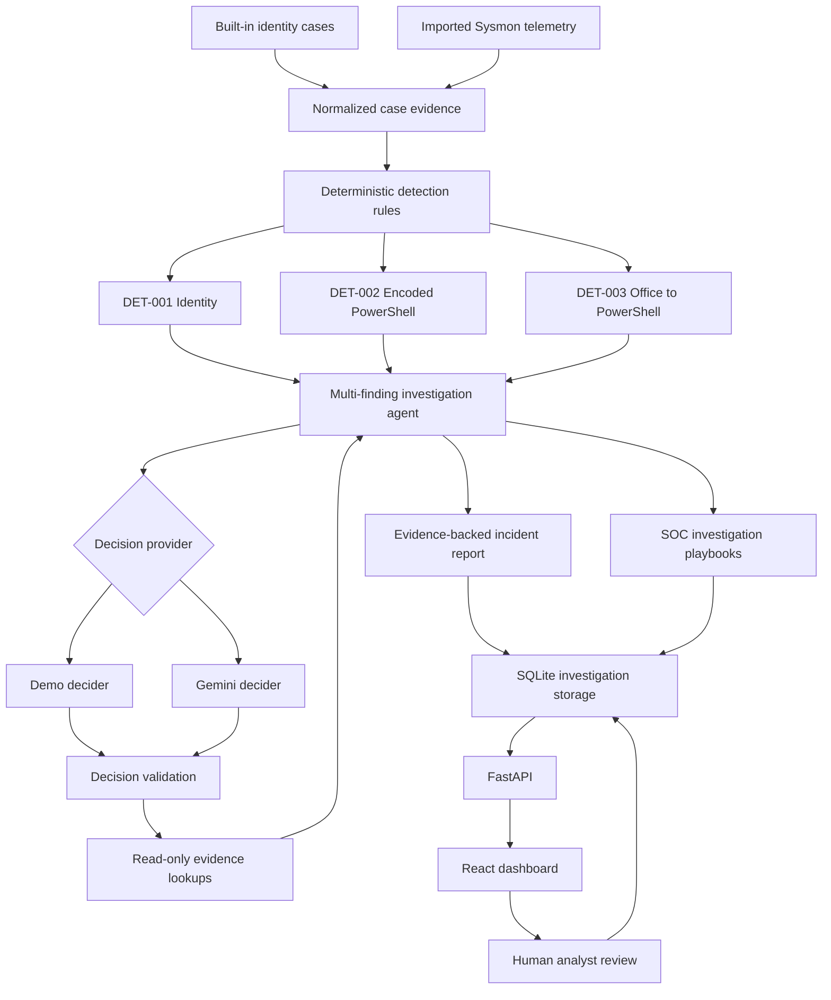

# Sentinel Casework — Security Architecture

## 1. Purpose and scope

Sentinel Casework is a local-first, evidence-backed SOC investigation
prototype built with FastAPI, React, SQLite, deterministic detection
rules, and optional Google Gemini assistance.

It uses synthetic identity and Sysmon telemetry for development,
testing, and demonstration.

It is not a production SIEM, EDR, SOAR, or autonomous containment tool.

## 2. Architecture

Optional AI narratives are generated separately and require
source-evidence reference validation.

## 3. Trust boundaries

### Boundary A — External telemetry

Imported events are untrusted input.

The ingestion layer normalizes supported Sysmon events and applies
input-size and event-count limits. Unsupported or malformed inputs
must be rejected.

Event fields, including command lines, usernames, and network
destinations, are treated as evidence data rather than instructions.

### Boundary B — LLM decisions

Gemini is an optional decision provider, not the authoritative
security analysis engine.

The agent validates requested actions against a restricted tool
allowlist and requires lookup values grounded in case evidence.

Model output must not grant itself new tools or permissions.

### Boundary C — Read-only investigation

Supported tools inspect existing case evidence:

- get_user_events
- get_ip_events
- get_process_events

These tools do not execute commands on endpoints, disable accounts,
block IP addresses, or alter source telemetry.

The agent has a bounded decision budget per finding and limits the
number of findings investigated in a run.

### Boundary D — Evidence-backed reporting

Detection findings reference source event identifiers.

Incident reports verify that referenced evidence exists.

Playbooks independently check required behavior and distinguish
available evidence from performed investigation lookups.

AI narratives may contain reasoning errors even when citations refer
to valid events. Human validation remains necessary.

### Boundary E — Persistence and human review

Investigation results are saved in SQLite.

Analyst reviews are stored separately from the original
investigation result to preserve the investigation record.

The project does not claim tamper-proof or cryptographically
immutable audit storage.

## 4. Threats and mitigations

| Threat | Existing mitigation | Remaining limitation |
|---|---|---|
| Fabricated evidence references | Event-ID validation | Valid citations can still support incorrect interpretations |
| Unsafe AI tool selection | Tool allowlist and decision validation | No comprehensive model red-team evaluation |
| Repeated or irrelevant lookups | Grounded identifiers, duplicate rejection, bounded execution | Limited enrichment scope |
| Malformed telemetry | Schema normalization and input restrictions | Not a hardened public ingestion service |
| False-positive detections | Positive/negative regression scenarios | Synthetic data is not production-representative |
| Unauthorized API access | Local-development usage boundary | No authentication or RBAC |
| Exposed sensitive evidence | Use only synthetic fixtures | No production data governance controls |
| Unauthorized response actions | Read-only tool architecture | No analyst-approved containment integration |

## 5. Evaluation boundaries

The project evaluates DET-001 with labeled identity scenarios and
DET-002/DET-003 with constructed Sysmon scenarios.

Precision, recall, and F1 scores on these fixtures measure regression
behavior within that test set.

They do not establish real-world detection accuracy or false-positive
rates.

An independent, representative dataset would be required for
broader effectiveness claims.

## 6. Known limitations

- No authentication, authorization, or RBAC
- No production SIEM or EDR connection
- No endpoint containment capabilities
- No distributed job queue or scalability guarantees
- No independent production-quality evaluation dataset
- No cryptographically protected audit log
- Limited simulated detection and investigation coverage
- Optional Gemini usage depends on provider access and availability

## 7. Responsible operation

Run the prototype locally with synthetic data.

Keep API credentials in environment variables, never in source
control or frontend bundles.

Do not upload employer telemetry, private incident records,
production credentials, or regulated personal data.

A human analyst must assess evidence before assigning a final
incident verdict or considering response actions.